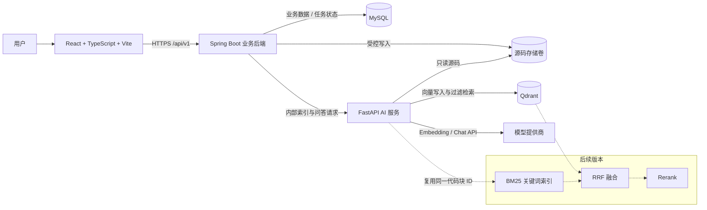

# CodeMind AI 系统设计与分阶段开发计划

> **历史计划说明（2026-10-29）：** 任务 1 的决策已冻结。本文仅保留初始设计过程，不再作为实现规范；若与当前文档存在差异，以 `docs/mvp-design-freeze.md` 及其关联的 API 契约、状态机和 ADR 为唯一依据。
> 本文仅包含架构、契约和验收计划，不包含业务代码，也不代表任何测试已经执行或通过。

**目标：** 交付一个可上传 Java/Python ZIP 项目、建立真实源码索引，并返回可核查文件路径、代码片段和行号的 AI 编程助手。

**架构：** React 前端只访问 Spring Boot；Spring Boot 负责上传安全、持久化与任务编排；FastAPI 负责解析、切块、检索和生成；MySQL 保存业务状态，Qdrant 保存向量，源码通过受控共享卷访问。

**技术栈：** React + TypeScript + Vite、Java + Spring Boot、Python + FastAPI、MySQL、Qdrant、BM25（后续）、Docker Compose。

---

## 0. 当前上下文与建议默认值

当前仓库仅有 Python 空骨架和 `IDEA.md`，尚无前端、Java 后端或基础设施实现。建议采用单仓库管理三个服务，并将现有 Python 骨架迁入 `ai-service/`，避免保留两套 Python 项目配置。

建议先按以下默认值推进，仍需所有者确认：

- MVP 面向本地单用户，不做登录注册，不暴露到公网。
- Java 使用当前组织可维护的 LTS 版本，构建工具优先 Maven；Python 使用 3.12。
- 首版使用 OpenAI 兼容的 Embedding 和 Chat 接口，通过环境变量配置；测试使用确定性的 Fake，不调用真实模型。
- 首版只索引 `.java`、`.py`，源码按 UTF-8 解码；其他编码和其他文件类型的支持后置。
- 首版为同步问答、单轮问答；上传和索引为异步任务。
- MVP 使用纯向量检索；BM25、RRF、Rerank 和评估按后续里程碑加入。

## A. 项目需求与 MVP 范围

### A.1 核心用户流程

1. 用户上传一个 Java/Python 项目 ZIP。
2. 后端校验压缩包与源码安全性，解包到受控存储。
3. AI 服务解析源码结构，按类、方法、函数等边界切块，并记录原始行号。
4. AI 服务生成向量并写入 Qdrant，后端更新索引任务状态。
5. 用户针对已就绪项目提问。
6. 系统检索真实代码块，将证据交给大模型生成回答。
7. 返回回答和证据列表：相对文件路径、起止行号、原文片段、证据序号。
8. 用户可查看对应源码，核对回答依据。

### A.2 MVP 必须包含

- ZIP 上传、大小/数量/路径/类型/压缩炸弹/高风险敏感信息检查。
- Java、Python 文件识别与结构化解析；解析失败时有固定大小切块降级策略。
- 项目、源码版本、索引任务状态持久化。
- 基于 Embedding + Qdrant 的向量检索。
- 基于检索证据的回答；无足够证据时明确返回“不足以回答”。
- 引用由真实检索结果构造，路径、片段和行号不由大模型编造。
- 上传进度/索引状态展示、提问、回答与引用展示。
- 统一异常结构、请求追踪 ID、超时、配置外置、基础日志脱敏。
- 后端、AI 服务、前端自动化测试，以及 Docker Compose 端到端验收脚本。

### A.3 MVP 明确不做

- 用户系统、权限系统、团队协作、公网多租户。
- Git 仓库导入、增量索引、分支切换。
- 多轮上下文追问、流式输出。
- BM25、RRF、Rerank（MVP 验收后按阶段加入）。
- 完整跨语言调用图、静态数据流分析、代码自动修改。
- 上传项目的编译、运行或任意代码执行。
- Kubernetes、分布式消息队列、复杂可观测性平台。

### A.4 MVP 总验收标准

使用一个包含已知 Java 类和 Python 函数的小型 fixture 项目：

- 合法 ZIP 可以上传并最终进入 `READY`。
- 非法路径、ZIP 炸弹、超限文件、高风险密钥样本均被拒绝或按明确策略隔离，临时文件被清理。
- 对 fixture 中已有实现提问，响应包含至少一条真实证据；证据片段与源文件对应起止行完全一致。
- 对源码中不存在的能力提问，系统不伪造文件或行号。
- 模型不可用时返回可诊断的错误，索引/问答状态不错误地显示成功。
- 上述结果必须通过真实测试和手工验收记录确认；当前不预设准确率或性能数字。

## B. 系统架构图（Mermaid）



关键约束：

- 浏览器不直接访问 FastAPI、MySQL 或 Qdrant。
- Spring Boot 是业务状态和项目访问边界；FastAPI 不直接修改 MySQL。
- AI 服务对源码卷只读，所有路径必须基于固定根目录解析并再次防止目录穿越。
- Qdrant 使用共享集合时，所有数据点和查询都必须携带并过滤 `project_id`、`source_version_id`，避免跨项目污染。
- 外部模型会接触检索到的源码，必须在文档和界面中明确提示；敏感信息检查不能替代用户授权。

## C. MySQL 初步表结构

统一约定：MySQL 8.x、InnoDB、`utf8mb4`、UTC 时间；ID 使用 `CHAR(36)` UUID；状态使用 `VARCHAR` 而非数据库 `ENUM`；通过迁移工具建表，禁止依赖 JPA 自动改生产表。

### C.1 `project`：项目主表

| 字段 | 类型/约束 | 说明 |
|---|---|---|
| `id` | `CHAR(36)` PK | 项目 ID |
| `name` | `VARCHAR(255)` NOT NULL | 展示名，可从安全文件名派生 |
| `status` | `VARCHAR(32)` NOT NULL | `INDEXING/READY/INDEX_FAILED/DELETING` |
| `active_source_version_id` | `CHAR(36)` NULL | 当前可用源码版本，逻辑关联 |
| `created_at`, `updated_at` | `DATETIME(6)` NOT NULL | 审计时间 |

索引：`status, created_at`。

### C.2 `source_version`：一次成功校验的源码快照

| 字段 | 类型/约束 | 说明 |
|---|---|---|
| `id` | `CHAR(36)` PK | 源码版本 ID |
| `project_id` | `CHAR(36)` FK NOT NULL | 所属项目 |
| `original_filename` | `VARCHAR(255)` NOT NULL | 原始文件名，仅用于展示 |
| `storage_key` | `VARCHAR(512)` NOT NULL | 相对存储键，不保存宿主机绝对路径 |
| `archive_sha256` | `CHAR(64)` NOT NULL | 上传完整性校验与排查 |
| `source_file_count` | `INT` NOT NULL DEFAULT 0 | 实际纳入的源码数 |
| `total_source_bytes` | `BIGINT` NOT NULL DEFAULT 0 | 解压后源码总大小 |
| `created_at` | `DATETIME(6)` NOT NULL | 创建时间 |

约束：`UNIQUE(storage_key)`；索引：`project_id, created_at`。

### C.3 `index_job`：索引任务

| 字段 | 类型/约束 | 说明 |
|---|---|---|
| `id` | `CHAR(36)` PK | 任务 ID |
| `source_version_id` | `CHAR(36)` FK NOT NULL | 对应源码版本 |
| `status` | `VARCHAR(32)` NOT NULL | `PENDING/RUNNING/SUCCEEDED/FAILED` |
| `processed_files` | `INT` NOT NULL DEFAULT 0 | 已处理文件数 |
| `chunk_count` | `INT` NOT NULL DEFAULT 0 | 最终代码块数 |
| `error_code` | `VARCHAR(64)` NULL | 稳定、可展示的错误码 |
| `error_message` | `VARCHAR(1000)` NULL | 脱敏后的错误摘要 |
| `started_at`, `finished_at`, `created_at`, `updated_at` | `DATETIME(6)` NULL/NOT NULL | 生命周期时间 |

约束：首版一个源码版本只允许一个有效任务；索引：`source_version_id, status`。

### C.4 `source_file`：源码文件元数据

| 字段 | 类型/约束 | 说明 |
|---|---|---|
| `id` | `CHAR(36)` PK | 文件 ID |
| `source_version_id` | `CHAR(36)` FK NOT NULL | 源码版本 |
| `relative_path` | `VARCHAR(1024)` NOT NULL | 规范化相对路径 |
| `language` | `VARCHAR(16)` NOT NULL | `JAVA/PYTHON` |
| `size_bytes` | `BIGINT` NOT NULL | 文件大小 |
| `line_count` | `INT` NOT NULL | 原始行数 |
| `sha256` | `CHAR(64)` NOT NULL | 内容摘要 |
| `parse_status` | `VARCHAR(32)` NOT NULL | `PARSED/FALLBACK/FAILED` |

约束：`UNIQUE(source_version_id, relative_path)`；索引：`source_version_id, language`。

### C.5 `conversation`：项目下的会话

| 字段 | 类型/约束 | 说明 |
|---|---|---|
| `id` | `CHAR(36)` PK | 会话 ID |
| `project_id` | `CHAR(36)` FK NOT NULL | 所属项目 |
| `title` | `VARCHAR(255)` NULL | 会话标题 |
| `created_at`, `updated_at` | `DATETIME(6)` NOT NULL | 审计时间 |

索引：`project_id, updated_at`。

### C.6 `message`：问题与回答

| 字段 | 类型/约束 | 说明 |
|---|---|---|
| `id` | `CHAR(36)` PK | 消息 ID |
| `conversation_id` | `CHAR(36)` FK NOT NULL | 所属会话 |
| `role` | `VARCHAR(16)` NOT NULL | `USER/ASSISTANT` |
| `content` | `MEDIUMTEXT` NOT NULL | 用户问题或模型回答 |
| `status` | `VARCHAR(32)` NOT NULL | `COMPLETED/FAILED` |
| `source_version_id` | `CHAR(36)` FK NULL | 本次问答使用的快照 |
| `model_name` | `VARCHAR(128)` NULL | 实际配置的模型名，不含密钥 |
| `retrieval_metadata` | `JSON` NULL | topK、耗时、检索模式等，不存密钥 |
| `created_at` | `DATETIME(6)` NOT NULL | 创建时间 |

索引：`conversation_id, created_at`。

### C.7 `message_citation`：回答证据快照

| 字段 | 类型/约束 | 说明 |
|---|---|---|
| `id` | `CHAR(36)` PK | 引用 ID |
| `message_id` | `CHAR(36)` FK NOT NULL | 对应助手消息 |
| `source_file_id` | `CHAR(36)` FK NOT NULL | 对应真实文件 |
| `citation_index` | `INT` NOT NULL | 回答中的 `[1]` 等序号 |
| `start_line`, `end_line` | `INT` NOT NULL | 原始文件行号，均从 1 开始且闭区间 |
| `snippet` | `MEDIUMTEXT` NOT NULL | 从真实源码截取的文字 |
| `retrieval_score` | `DOUBLE` NULL | 原始分数，不解释为百分比 |
| `created_at` | `DATETIME(6)` NOT NULL | 创建时间 |

约束：`CHECK(start_line >= 1 AND end_line >= start_line)`；`UNIQUE(message_id, citation_index)`。

说明：代码块正文和向量不必同时存 MySQL；MVP 的权威文本是源码快照，Qdrant payload 保存代码块定位信息和检索所需文本。若后续源码允许删除，需要同步定义引用快照的保留策略。

## D. 前后端及 AI 服务接口清单

### D.1 统一接口约定

- 业务 API 前缀 `/api/v1`，AI 内部 API 前缀 `/internal/v1`。
- 写操作返回明确资源 ID 和状态；上传返回 `202`，问答成功返回 `200`。
- 统一错误体：`errorCode`、`message`、`traceId`；不向用户返回堆栈、密钥、宿主机绝对路径。
- 所有请求有大小限制和超时；内部接口要求服务凭证并只监听内部 Docker 网络。
- AI 返回的引用必须来自检索 payload，后端或 AI 服务可验证其属于当前 `source_version_id`。

### D.2 浏览器 → Spring Boot

| 方法 | 路径 | 用途 | 成功响应/备注 |
|---|---|---|---|
| `POST` | `/api/v1/projects/upload` | multipart 上传 ZIP | `202`：项目、源码版本、索引任务 ID |
| `GET` | `/api/v1/projects/{projectId}` | 项目及当前索引状态 | 项目详情 |
| `DELETE` | `/api/v1/projects/{projectId}` | 删除项目、源码及向量 | `202/204`，需处理部分失败 |
| `GET` | `/api/v1/index-jobs/{jobId}` | 轮询索引进度 | 状态、计数、脱敏错误 |
| `POST` | `/api/v1/conversations` | 在 READY 项目下创建会话 | `201`：会话 ID |
| `GET` | `/api/v1/conversations/{conversationId}` | 获取历史消息与引用 | 按时间排序 |
| `POST` | `/api/v1/conversations/{conversationId}/questions` | 单轮源码问答 | 回答、引用、检索元数据 |
| `GET` | `/api/v1/source-versions/{versionId}/file` | 查看指定源码片段 | 参数：`path/startLine/endLine`，严格校验范围和归属 |
| `GET` | `/actuator/health` | 后端健康检查 | 不暴露敏感配置 |

问题请求首版只包含 `question`，限制长度与空白输入；`topK`、检索策略和模型选择不开放给普通前端，避免接口成为无限制模型代理。

问答响应中的每条引用至少包含：`citationIndex`、`filePath`、`startLine`、`endLine`、`snippet`。回答正文与引用数组分离，前端不通过正则猜文件位置。

### D.3 Spring Boot → FastAPI（仅内部网络）

| 方法 | 路径 | 用途 | 核心输入/输出 |
|---|---|---|---|
| `POST` | `/internal/v1/indexes` | 解析、切块并建立索引 | 输入项目/版本 ID、相对存储键；输出文件数、代码块数 |
| `POST` | `/internal/v1/qa` | 检索并生成有引用的回答 | 输入项目/版本 ID、问题；输出回答与真实证据 |
| `POST` | `/internal/v1/retrievals` | 独立调试和评估检索 | 输入查询与版本；输出代码块及原始分数 |
| `DELETE` | `/internal/v1/indexes/{sourceVersionId}` | 删除该版本向量及后续 BM25 数据 | 输出删除结果，支持重试 |
| `GET` | `/health/live`、`/health/ready` | 存活与就绪检查 | ready 检查必要依赖和模型配置 |

内部索引请求不能只信任调用方传入的任意路径：AI 服务仍以配置的源码根目录为边界，规范化并验证路径。索引和问答必须显式绑定 `source_version_id`，不能只按项目 ID 检索。

## E. 项目目录结构

```text
codemind-ai/
├─ frontend/
│  ├─ src/
│  │  ├─ api/                 # 类型化 API 客户端与错误映射
│  │  ├─ components/          # 上传、状态、回答、代码引用组件
│  │  ├─ pages/
│  │  ├─ types/               # 与公开契约对应的 TypeScript 类型
│  │  └─ test/
│  ├─ tests/e2e/              # Playwright（可在仓库级 tests 统一）
│  └─ package.json
├─ backend/
│  ├─ src/main/java/com/codemind/
│  │  ├─ common/              # 异常、追踪、配置、通用响应
│  │  ├─ project/
│  │  ├─ upload/              # ZIP 安全校验与安全解包
│  │  ├─ indexing/            # AI 客户端与任务状态编排
│  │  ├─ conversation/
│  │  └─ source/              # 受控源码读取
│  ├─ src/main/resources/db/migration/
│  ├─ src/test/               # 单元、契约、Testcontainers 测试
│  └─ pom.xml
├─ ai-service/
│  ├─ src/codemind_ai/
│  │  ├─ api/                 # FastAPI 路由、请求响应模型、异常映射
│  │  ├─ application/         # 索引、检索、问答用例
│  │  ├─ domain/              # CodeChunk、Citation 等稳定模型
│  │  ├─ parsing/             # Java/Python 解析及降级切块
│  │  └─ infrastructure/
│  │     ├─ embedding/
│  │     ├─ llm/
│  │     ├─ qdrant/
│  │     └─ storage/
│  ├─ tests/
│  │  ├─ fixtures/            # 最小 Java/Python 项目与恶意 ZIP 样本
│  │  ├─ unit/
│  │  ├─ contract/
│  │  └─ integration/
│  └─ pyproject.toml
├─ deploy/
│  ├─ docker-compose.yml
│  ├─ docker-compose.test.yml
│  └─ env.example             # 仅变量名和安全示例，无真实密钥
├─ docs/
│  ├─ api/
│  ├─ architecture/
│  ├─ adr/                    # 关键架构决策记录
│  └─ evaluation/
├─ scripts/                   # 启动、测试、端到端验收脚本
├─ .github/workflows/ci.yml
├─ .gitignore
└─ README.md
```

目录按“业务边界 + 分层”组织，不为每个小类建立无意义包。公开 DTO、内部 DTO 和数据库实体分离，避免数据库结构直接泄漏到前端。

## F/G. 按依赖排序的任务、验收标准和测试方法

以下均为待执行任务；“通过”必须以实际命令输出、测试报告或验收记录为准。

| # | 任务与依赖 | 交付内容 | 验收标准与测试方法 |
|---|---|---|---|
| 1 | **冻结契约与决策**，无前置 | 确认模型、限额、单体/单用户边界；记录 OpenAPI 初稿、错误码、状态机、ADR | 评审上传→索引→问答→删除全链路；前端、Java、Python 对同一字段/状态无歧义；不进入实现前解决开放决策 |
| 2 | **单仓库与基础工程**，依赖 1 | 三服务最小健康检查、依赖锁定、格式化/静态检查、环境变量模板、CI 骨架 | 三服务分别启动且健康检查成功；CI 实际执行后端测试、pytest、前端类型检查/测试；无密钥进入 Git |
| 3 | **MySQL 与 Compose 基座**，依赖 2 | MySQL、Qdrant、共享源码卷、网络隔离、非 root 容器、迁移脚本和健康检查 | 从干净卷执行 Compose；迁移可重复启动且版本一致；MySQL/Qdrant 无宿主机不必要端口；Testcontainers 验证约束与外键 |
| 4 | **后端项目与源码版本持久化**，依赖 3 | 项目/版本/任务 Repository、状态迁移、统一异常和追踪 ID | JUnit + MySQL Testcontainers 验证合法迁移和非法迁移；非法状态不能变成 READY；错误体无堆栈/绝对路径 |
| 5 | **ZIP 安全上传与安全解包**，依赖 4 | 流式限额、路径规范化、白名单、重复路径/加密/链接检测、敏感信息检查、临时清理 | 参数化安全测试覆盖 `../`、绝对路径、Windows 盘符、UNC、混合分隔符、ZIP 炸弹、虚假扩展、加密包、超大/超多文件、重复规范化路径、私钥样本；合法 Java/Python fixture 成功；失败后无残留 |
| 6 | **AI 解析与统一切块模型**，依赖 5 的输出契约 | Java/Python 结构解析、固定窗口降级、稳定 chunk ID、原始行号、空文件/语法错误处理 | pytest fixture 验证类/方法/函数边界；`snippet == 原文件 startLine..endLine`； CRLF/LF、Unicode、无结尾换行、语法错误、超长方法均有测试；相同输入得到相同 ID |
| 7 | **Embedding 与 Qdrant 索引**，依赖 3、6 | 可替换 Embedding 端口、批量/重试、Qdrant payload 与版本过滤、失败清理 | 单元测试使用 Fake Embedding，验证维度错误/部分失败；Qdrant 集成测试验证仅检索指定项目与版本；重复索引不产生重复有效点；无真实 API 也可运行 CI |
| 8 | **向量检索与证据构造**，依赖 7 | topK、相似度阈值、无结果分支、检索 DTO、源码引用生成 | 确定性 Fake 向量验证排序和过滤；引用全部来自实际代码块；无结果不调用 Chat 模型；文件归属、行号、snippet 自动校验 |
| 9 | **受约束问答与模型异常处理**，依赖 8 | Chat Provider、证据提示词、引用序号校验、超时/限流/上游错误映射 | Fake LLM 覆盖正常回答、无依据、伪造引用、无效结构、超时和 429；系统丢弃/拒绝非法引用并明确降级；密钥和完整提示词不进入日志 |
| 10 | **Spring 任务编排与问答 API**，依赖 5、7、9 | 后台索引任务、状态更新、会话/消息/引用持久化、AI 客户端超时与删除编排 | 契约测试模拟 AI 成功/失败/超时；任务不会永久停留 RUNNING（含明确失败或可恢复策略）；仅 READY 项目可问答；数据库引用与 AI 证据一致 |
| 11 | **React MVP 界面**，依赖 10 的 OpenAPI | 上传、轮询状态、错误展示、会话、回答、代码引用和源码查看 | Vitest/RTL 覆盖上传错误、轮询结束、无证据、引用展示；类型由契约生成或契约测试保证一致；XSS 样本按纯文本渲染，不注入 HTML |
| 12 | **Docker 端到端 MVP 验收**，依赖 11 | 一键启动、fixture、端到端脚本、初始化/清理、README | 从干净环境运行 Compose 和 Playwright/API E2E；完成合法上传→READY→提问→核对引用；恶意 ZIP 返回明确错误；模型故障可诊断；报告真实结果，不写虚构指标 |
| 13 | **MVP 安全与质量复核**，依赖 12 | 依赖扫描、日志审计、资源限制、异常恢复、测试报告、架构与面试说明 | 检查仓库无密钥、服务最小暴露、AI 只读源码卷；模拟进程中断并验证恢复策略；所有 CI 测试真实通过后标记 MVP 完成 |

### MVP 之后的独立里程碑

| # | 任务与依赖 | 验收标准与测试方法 |
|---|---|---|
| 14 | **BM25 关键词检索**，依赖 13，复用任务 6 的同一代码块 | 同一查询可同时得到向量与 BM25 候选；chunk ID 可一一对应；中文标识符/注释、英文类名、精确符号查询有 fixture；索引删除无残留 |
| 15 | **RRF 混合检索**，依赖 14 | 固定候选列表下用手工计算的 RRF 结果断言排序；任一路为空仍可工作；参数有边界测试；与纯向量结果可对照，不提前声称效果提升 |
| 16 | **Rerank**，依赖 15，且先证明有质量需求 | 使用可替换 Reranker；Fake 验证排序、超时回退、topN 截断；真实模型质量通过固定数据集对比后才默认启用 |
| 17 | **检索与回答评估**，依赖 14；可持续扩展 | 建小型人工标注集：问题、相关文件/行范围；输出 Recall@K、MRR/nDCG（按选定定义）、引用定位正确率；模型回答另行人工抽样，所有报告附数据版本、配置和实际运行时间 |
| 18 | **后续体验能力**，依赖 13，按优先级单独立项 | 多轮追问、Git 导入、增量索引、流式回答分别设计、分别测试，不与检索算法改造混在一个不可验收阶段 |

### 建议测试分层

- **后端：** JUnit 5、Mockito/契约测试、MySQL Testcontainers；安全测试必须包含恶意 ZIP 的实际字节样本。
- **AI 服务：** pytest；解析和 RRF 使用确定性单元测试；Qdrant 使用集成测试；模型供应商用 Fake，少量真实 API 冒烟测试与 CI 分离。
- **前端：** Vitest + React Testing Library；关键流程用 Playwright。
- **端到端：** Compose 启动真实服务，验证跨服务契约和状态，而不是只测各服务健康检查。
- **证据正确性：** 自动从原 fixture 重新读取起止行并与响应 snippet 比较，这是项目最核心的验收断言。

## H. 主要风险与缓解措施

| 风险 | 影响 | 缓解措施 |
|---|---|---|
| ZIP 穿越、炸弹、伪扩展、敏感文件 | 任意写文件、资源耗尽、密钥泄漏 | 流式实际字节计数、安全根目录、白名单、严格路径规范化、内容检测、失败清理；不执行上传代码 |
| 外部模型看到私有源码 | 数据合规和泄漏 | 明确用户授权与提示；默认最少上下文；密钥外置；后续提供本地模型选项 |
| 行号或片段与源码不一致 | 核心可信度失效 | 切块保留原文和闭区间行号；引用由系统构造；自动回读源文件校验 |
| 大模型编造结论或引用 | 回答不可信 | 只提供检索证据、无证据拒答、校验引用序号；明确“有引用”不等于语义完全正确，仍需评估 |
| Java 语法复杂、Python 动态特性 | 结构和调用链理解不完整 | MVP 只承诺检索和证据，不承诺完整调用图；解析失败可降级并记录状态 |
| 跨项目/版本向量污染 | 返回其他项目代码 | 所有点和查询强制双过滤；集成测试覆盖两个项目及两个版本 |
| 同步索引/问答阻塞、上游超时 | 请求堆积、状态卡死 | 上传索引异步化；问答有超时；任务有失败/恢复策略；首版不引入 MQ |
| Embedding 模型或维度变化 | 旧向量不可用 | 记录模型配置；维度变化触发新版本重建；启动时检查集合维度 |
| 检索质量不稳定 | 演示效果差 | 先建立可复现 fixture 和检索评估，再加入 BM25/RRF/Rerank；不靠主观案例宣称提升 |
| 单用户无认证被误部署公网 | 源码和模型额度暴露 | README 明确本地边界；公网部署前认证、授权、限流和 HTTPS 是阻断项 |

## I. 已冻结决策（历史章节已替换）

本节原有的待确认项已在任务 1 中全部确定。当前唯一依据为：

- `docs/mvp-design-freeze.md`
- `docs/api/mvp-api-contract.md`
- `docs/architecture/state-machine.md`
- `docs/adr/0001-external-model-api-and-source-privacy.md`

历史正文不再保留，避免把旧建议误读为仍待决策的规范。

## J. 应推迟到后续版本的功能

- Git URL 导入、Webhook、增量索引和分支管理。
- 多用户登录、组织权限、分享链接和公网多租户。
- 完整调用链/依赖图、跨文件符号解析、GraphRAG。
- 多轮上下文、流式输出、提示词模板市场。
- 自动改代码、生成 PR、运行或测试用户上传的项目。
- 本地模型适配、多模型路由、复杂缓存和成本面板。
- 分布式任务队列、Kubernetes、微服务治理。
- 大规模评估平台与性能优化；应先有小而可信的评估集，再扩展。

**推荐下一步：** 所有者先确认第 I 节决策，然后只执行任务 1（冻结契约和状态机），评审通过后再开始任务 2，不一次性生成全项目代码。
