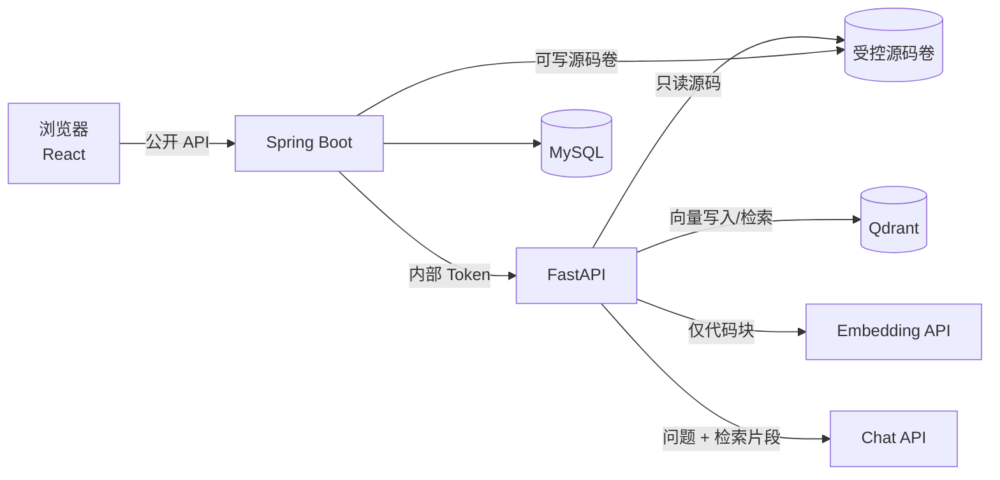

# CodeMind AI

CodeMind AI 是一个本地单用户的 Java/Python 代码库分析与问答工具。上传 ZIP 后，系统解析真实源码结构、建立向量索引，并在回答中返回**可核查的文件路径、闭区间行号和源码片段**。

> 当前状态：**MVP 主链路已完成并运行验收**。上传安全校验 → 异步解析切块 → Embedding → Qdrant 索引 → 向量检索 → 受约束问答 → MySQL 引用快照 → React 展示已连通。

## 1. 已实现能力

- React + TypeScript + Vite 前端：项目上传、索引进度、会话问答、引用卡片与源码查看。
- Spring Boot 业务后端：安全解包、隐私确认、项目/任务状态、异步索引编排、会话与消息持久化。
- FastAPI AI 服务：Python AST / Java tree-sitter 解析、结构切块、OpenAI 兼容 Embedding、Qdrant 写入与检索、受约束问答。
- MySQL 8：Flyway 管理 7 张核心表，JPA `ddl-auto=validate`。
- Qdrant：向量写入、双 ID 过滤、精确点数校验、版本清理。
- 所有引用由服务端根据真实检索结果构造，不采用模型返回的路径或行号。
- 自动化测试使用 Fake / Mock HTTP，不产生真实模型费用。

### 暂不包含

- 登录、多租户、Git 仓库导入、团队协作。
- 多轮上下文、流式输出、代码修改与 PR 生成。
- BM25、RRF、Rerank、检索评估；属于 MVP 之后的混合检索迭代。
- 公网部署所需的认证、限流与 HTTPS。

## 2. 架构



职责边界：

- 浏览器只能访问 Spring Boot，不能直连 FastAPI、MySQL 或 Qdrant。
- Spring Boot 是业务状态与引用的权威来源。
- FastAPI 不写 MySQL，只处理解析、向量与问答。
- Qdrant 查询始终同时过滤 `project_id` 与 `source_version_id`，防止旧版本污染。
- 模型 API 密钥只存在服务端环境变量，不进入前端、日志或 Git。

## 3. 快速开始

### 3.1 依赖

- Java 21+、Maven Wrapper
- Python 3.12 + uv
- Node.js 24 + npm
- MySQL 8.x
- Qdrant 1.20+

### 3.2 配置

```bash
cp deploy/env.example deploy/.env
# 编辑 deploy/.env，替换数据库密码、内部 Token 和模型配置
```

`deploy/.env` 已被 Git 忽略。不要把真实密钥发到聊天或提交到仓库。

模型配置支持分别指定 Chat 与 Embedding 服务：

```dotenv
CODEMIND_CHAT_BASE_URL=https://your-provider.example/v1
CODEMIND_CHAT_MODEL=your-chat-model
CODEMIND_CHAT_API_KEY=...
CODEMIND_EMBEDDING_BASE_URL=https://your-provider.example/v1
CODEMIND_EMBEDDING_MODEL=your-embedding-model
CODEMIND_EMBEDDING_API_KEY=...
CODEMIND_EMBEDDING_DIMENSIONS=1536
```

`CODEMIND_EMBEDDING_DIMENSIONS` 必须与模型真实输出一致；Qdrant 集合首次创建后维度不可混用。

### 3.3 启动 MySQL

```bash
mysqld --datadir=deploy/data/mysql --port=3307 --bind-address=127.0.0.1 --console
```

数据库连接通过 `CODEMIND_DATABASE_URL`、`CODEMIND_DATABASE_USERNAME`、`CODEMIND_DATABASE_PASSWORD` 配置。

### 3.4 启动 Qdrant

```bash
QDRANT__SERVICE__HOST=127.0.0.1 \
QDRANT__SERVICE__HTTP_PORT=6333 \
QDRANT__STORAGE__STORAGE_PATH=deploy/data/qdrant-storage \
./qdrant
```

仓库不会提交 Qdrant 二进制或向量数据。

### 3.5 启动 AI 服务

```bash
cd ai-service
uv sync --frozen --group dev
uv run uvicorn codemind_ai.main:app --host 127.0.0.1 --port 8000
```

AI 服务从与 `deploy/.env` 同名的环境变量读取配置。`GET /health/ready` 会真实检查配置与 Qdrant，不会调用付费模型。

### 3.6 启动 Spring Boot

```bash
cd backend
./mvnw spring-boot:run
```

Windows 使用 `./mvnw.cmd`。启动时需要 `CODEMIND_AI_BASE_URL`、`CODEMIND_INTERNAL_SERVICE_TOKEN`、`CODEMIND_SOURCE_ROOT` 和数据库配置。

### 3.7 启动前端

```bash
cd frontend
npm ci
npm run dev
```

打开 <http://127.0.0.1:5173/>。Vite 已将 `/api` 代理到 `127.0.0.1:8080`。

### 3.8 无真实模型密钥时演示

仓库提供**仅用于本地演示**的 OpenAI 兼容 Mock：

```bash
python scripts/mock_openai_provider.py   # 127.0.0.1:8010，确定性哈希向量
```

将 AI 服务环境变量临时指向它：

```dotenv
CODEMIND_CHAT_BASE_URL=http://127.0.0.1:8010/v1
CODEMIND_EMBEDDING_BASE_URL=http://127.0.0.1:8010/v1
CODEMIND_CHAT_MODEL=local-mock-chat
CODEMIND_EMBEDDING_MODEL=local-hash-64
CODEMIND_EMBEDDING_DIMENSIONS=64
```

Mock 不调用外部模型，也不代表生产模型质量；项目页面会如实显示当前配置地址。

## 4. API

| 方法 | 路径 | 说明 |
|---|---|---|
| GET | `/api/v1/privacy-notice` | 当前模型地址、外发数据类型、隐私边界 |
| POST | `/api/v1/projects/upload` | 上传 ZIP，返回 `202 INDEXING` |
| GET | `/api/v1/projects` | 最近项目 |
| GET | `/api/v1/projects/{projectId}` | 项目与索引状态 |
| DELETE | `/api/v1/projects/{projectId}` | 删除源码、数据库记录与向量 |
| GET | `/api/v1/index-jobs/{jobId}` | 索引任务进度 |
| POST | `/api/v1/conversations` | 为 READY 项目创建会话 |
| GET | `/api/v1/conversations/{conversationId}` | 会话与历史消息 |
| POST | `/api/v1/conversations/{conversationId}/questions` | 单轮提问 |
| GET | `/api/v1/source-versions/{versionId}/file` | 受控读取真实源码区间 |
| GET | `/actuator/health` | 聚合健康状态 |

内部接口 `/internal/v1/indexes`、`/internal/v1/retrievals`、`/internal/v1/qa` 和删除接口要求 `Authorization: Bearer <CODEMIND_INTERNAL_SERVICE_TOKEN>`。

完整字段、错误码与示例见 [API 契约](docs/api/mvp-api-contract.md)。

## 5. 测试

```bash
# AI
cd ai-service
uv run ruff check .
uv run ruff format --check .
uv run pytest

# Spring Boot
cd backend
./mvnw verify

# React
cd frontend
npm run typecheck && npm test && npm run build
```

2026-11-03 本机实际结果：

- AI：**31 passed, 1 skipped**（真实 Qdrant 用例默认跳过；指定 `CODEMIND_TEST_QDRANT_URL` 后单独执行通过）。
- Spring Boot：**21 tests, 0 failures, 1 skipped**（MySQL Testcontainers 因本机无 Docker 跳过）。
- React：**2 passed**，TypeScript 类型检查和生产构建通过。
- 真实 Qdrant 写入、计数、项目隔离、清理通过。
- 真实浏览器端到端：上传后 `READY`，中文提问返回 `src/auth_service.py:1-13` 等引用，点击引用能读取真实源码。

更完整的证据与未验收边界见 [验收报告](docs/acceptance-report.md)。

## 6. 安全与隐私

- ZIP 限制：最大 50 MB；解压后 200 MB；10,000 条目；单文件 2 MB；路径深度 20；压缩比 100。
- 拒绝路径穿越、绝对路径、盘符、UNC、加密 ZIP、符号链接和规范化重复路径。
- 只索引 UTF-8 `.java` / `.py`。
- 高置信度私钥/Token 命中时拒绝上传并清理临时文件。
- 索引代码块会发送给 Embedding 服务；问答时的检索片段会发送给 Chat 服务。前端在上传前明确告知并取得确认。
- 不发送完整 ZIP、整个项目、未检索源码、宿主机绝对路径或已识别秘密。
- 模型错误响应经脱敏，不把上游正文或源码写入普通日志。
- 本地敏感信息检测**不能保证**识别所有秘密，用户仍需自行审查。

## 7. 设计文档

1. [MVP 设计冻结](docs/mvp-design-freeze.md)
2. [API 契约](docs/api/mvp-api-contract.md)
3. [状态机](docs/architecture/state-machine.md)
4. [模型与源码隐私 ADR](docs/adr/0001-external-model-api-and-source-privacy.md)
5. [测试验收清单](docs/testing/mvp-acceptance-checklist.md)
6. [本机验收报告](docs/acceptance-report.md)

## 8. 已知边界

- Docker Compose 配置已完成静态检查，但开发机没有 Docker，尚未执行 Compose 端到端启动。
- 向量检索只做 Cosine Top-K；BM25、RRF、Rerank 和检索评估按迭代计划后续加入。
- 索引恢复依赖数据库任务状态与服务启动扫描；AI 侧版本锁为进程内锁，不是分布式锁。
- 演示用 Mock 模型只验证工程链路，不代表真实模型的回答质量。

## 9. 后续迭代

1. 接入真实 Embedding / Chat 模型并建立检索评估集。
2. 加入 BM25 + RRF 混合检索与 Rerank。
3. 增加多轮会话、流式输出和引用去重。
4. 完成 Docker Compose 与 CI 端到端验收。
5. 公网部署前加入用户认证、限流、审计与 HTTPS。
