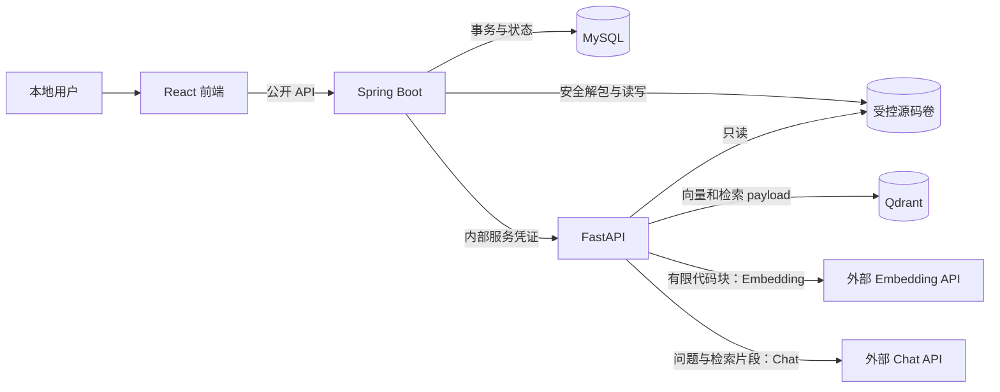

# CodeMind AI MVP 设计冻结

- 文档状态：**已冻结，作为 MVP 实现的唯一顶层规范**
- 冻结日期：2026-10-29
- 适用范围：任务 1 及后续 MVP 实现
- 变更规则：实现不得静默偏离本文；确需变更时，先更新本文及相关 ADR、契约和验收清单

## 1. 规范入口与文档边界

本文冻结范围、架构、安全和数据约束。详细规则分别在以下文档中维护，避免复制多份相互冲突的规格：

| 文档 | 唯一职责 |
|---|---|
| [MVP API 契约](api/mvp-api-contract.md) | 所有公开/内部接口、字段、示例、状态码、超时、重试和幂等 |
| [项目与索引任务状态机](architecture/state-machine.md) | 状态转换、恢复、删除和版本切换 |
| [ADR 0001：外部模型 API 与源码隐私](adr/0001-external-model-api-and-source-privacy.md) | 模型选型、源码外发、敏感信息和配置决策 |
| [MVP 测试验收清单](testing/mvp-acceptance-checklist.md) | 可执行验收项和证据要求 |

`.hermes/plans/2026-10-29_112028-codemind-ai-design.md` 是历史计划，不再作为规范来源。`IDEA.md` 仅描述产品愿景。

## 2. 已冻结范围

### 2.1 产品与技术

- 本地单用户，不实现登录、权限和多租户，不直接暴露公网。
- React + TypeScript + Vite；Spring Boot + Maven + Java LTS；FastAPI + Python 3.12 + uv。
- MySQL 8.x、InnoDB、`utf8mb4`；Qdrant；Docker Compose。
- 仅索引 UTF-8 的 `.java`、`.py`；UTF-8 BOM 可去除，但不得改变后续文本的行号映射。
- 上传后异步索引；问答同步、单轮、非流式。
- MVP 仅向量检索，不实现 BM25、RRF、Rerank。
- 自动化测试默认使用 Fake Embedding、Fake LLM；真实 API 冒烟测试独立于 CI。
- 不执行上传源码，不自动修改代码，不生成 PR。
- 不引入 Redis、消息队列、Kubernetes 或复杂微服务治理。
- 保留项目、源码版本、索引任务、会话、消息和引用快照。

### 2.2 核心验收结果

用户上传合法 ZIP 后，项目只有在完整索引成功时才进入 `READY`。用户只能对 `READY` 项目问答。回答引用必须由真实检索结果构造，并能通过 `source_version_id + relative_path + startLine/endLine` 回读到完全一致的源码片段。

当前没有实现或测试结果，不得据此宣称功能、准确率或性能已经达标。

## 3. 冻结架构

职责边界：

1. 浏览器只访问 Spring Boot，不能直接访问 FastAPI、MySQL、Qdrant 或模型 API。
2. Spring Boot 负责上传安全、隐私确认、业务状态、任务编排、MySQL 和对外 DTO。
3. FastAPI 负责解析、切块、Embedding、Qdrant、检索和受约束问答，不直接修改 MySQL。
4. “后端调用外部模型”在本架构中专指服务端 FastAPI；Spring Boot 和浏览器均不持有模型密钥。
5. AI 服务对源码卷只读，并在固定根目录下重新规范化、校验 `storage_key`。
6. Chat 与 Embedding 是外部依赖，不保存项目权威状态，不负责源码索引状态，也不负责生成可信的文件路径、行号或代码片段。
7. MySQL 是业务状态权威来源；受控源码卷是源码文本权威来源；Qdrant 是可重建的检索索引。
8. 内部 API 仅监听内部网络。除无敏感信息的存活/就绪检查外，必须校验 `Authorization: Bearer <内部服务凭证>`。
9. 公开 DTO、内部 DTO、数据库实体分别建模，禁止互相替代。

## 4. 上传与本地安全边界

### 4.1 冻结限额

| 项目 | 限制 |
|---|---:|
| ZIP 压缩大小 | 最大 50 MB |
| 实际解压总大小 | 最大 200 MB，按流式读取的真实字节累计 |
| ZIP 条目数 | 最大 10,000，包含目录和非源码条目 |
| 单个源码文件 | 最大 2 MB |
| 规范化路径深度 | 最大 20 |
| 解压大小/压缩大小 | 大于 100 拒绝；压缩大小为 0 且存在数据时拒绝 |

超过任一边界即拒绝整个上传。不得只信任 ZIP 头部声明的大小。

### 4.2 路径、类型和编码

- 拒绝 `..` 穿越、绝对路径、Windows 盘符、UNC、NUL、混合分隔符绕过及逃逸固定根目录的路径。
- 拒绝加密 ZIP、符号链接、重复规范化路径。为实现跨平台稳定性，重复检查使用 Unicode NFC、统一 `/` 分隔符及不区分大小写的规范化副本；原始合法相对路径用于展示。
- 仅解包 `.java`、`.py`。其他条目不落盘、不索引、不外发；没有可用源码文件时拒绝上传。
- 白名单源码必须以严格 UTF-8 解码；任一白名单文件编码不支持即拒绝整个上传并清理临时文件。
- 解包目录使用随机资源 ID，不使用原始文件名作为物理路径。
- 不编译、不导入、不运行上传代码，不使用云端模型扫描完整文件。

### 4.3 敏感信息

- 在任何 Embedding 或 Chat 请求之前，于本地扫描将外发的白名单源码。
- 高置信度私钥、访问令牌等规则命中时拒绝整个上传，删除临时文件，并返回不含秘密值的安全错误。
- 已识别秘密不得进入模型请求、普通日志、测试报告或错误消息。
- **本地检测不可能识别所有秘密，不提供 100% 检测保证。** 用户仍须在上传前自行审查代码和第三方数据政策。

## 5. 源码外发与隐私告知

### 5.1 允许外发

- Embedding：单个或有限批量的代码块文本，以及生成向量所需的最少元数据。
- Chat：用户问题、必要提示词、本次检索选中的代码片段及不含敏感信息的相对定位元数据。

Embedding 与 Chat 都会使代码文本离开本机。禁止发送完整 ZIP、整个源码目录、默认未选中的全部源码、宿主机绝对路径或已识别秘密。

### 5.2 上传前告知

前端调用 `GET /api/v1/privacy-notice`，在上传前展示：

- 当前配置的 Embedding 与 Chat 服务地址；地址必须去除用户信息、查询参数和片段，绝不返回密钥。
- 各自发送的数据类型与用途。
- “第三方可能按其政策保留数据，用户需自行确认”的提示。
- 本地敏感信息检测的能力边界。
- 当前 `noticeVersion`。

Spring Boot 只读取与 AI 相同的非敏感 baseUrl 配置以生成告知；模型密钥仅注入 AI 容器，Spring Boot 不持有模型密钥。

上传必须同时提交已确认的 `noticeVersion` 和 `externalTransferAccepted=true`。版本不匹配或确认缺失时拒绝上传，不用默认勾选代替用户确认。

### 5.3 日志与元数据

允许记录提供商标识、模型名、traceId、耗时、请求/响应 token 数（若提供商返回）和脱敏错误类别。禁止记录完整模型请求体、响应中的完整源码、Authorization、API 密钥或私钥内容。

模型错误仅返回稳定错误码和安全摘要，不向上层透传可能包含请求片段的上游响应正文。不得伪造成功或静默切换到未配置的模型。

详细理由见 [ADR 0001](adr/0001-external-model-api-and-source-privacy.md)。

## 6. MySQL 冻结约束

### 6.1 通用规则

- 七张表：`project`、`source_version`、`index_job`、`source_file`、`conversation`、`message`、`message_citation`。
- 主键和资源 ID 均为 `CHAR(36)` UUID 字符串；时间使用 UTC `DATETIME(6)`。
- 所有表 InnoDB、`utf8mb4`；使用迁移工具，禁止 JPA 自动更新生产结构。
- 外键默认 `ON UPDATE RESTRICT`。项目删除采用显式编排；完成向量与源码处理后，业务数据按下列规则级联或置空。
- 状态字段由应用检查合法迁移，数据库用 `CHECK` 限制枚举值；错误文本必须脱敏。

### 6.2 表、约束和索引

| 表 | 必要字段与补充 | 外键、唯一约束和索引 |
|---|---|---|
| `project` | `id`、`name`、`status`、`active_source_version_id NULL`、`last_error_code NULL`、`last_error_message NULL`、时间 | `active_source_version_id` FK → `source_version.id`，`ON DELETE SET NULL`；`INDEX(status, created_at)` |
| `source_version` | `project_id`、`original_filename`、`storage_key`、`archive_sha256`、文件/字节计数、时间 | `project_id` FK → `project.id`，`ON DELETE CASCADE`；`UNIQUE(storage_key)`；`UNIQUE(id, project_id)` 用于一致性检查；`INDEX(project_id, created_at)` |
| `index_job` | `source_version_id`、`status`、`attempt_count`、`max_attempts`、进度、代码块数、脱敏错误、心跳和时间 | `source_version_id` FK，`ON DELETE CASCADE`；`UNIQUE(source_version_id)`；`INDEX(status, updated_at)`；`attempt_count BETWEEN 0 AND max_attempts` |
| `source_file` | `source_version_id`、`relative_path`、`relative_path_sha256`、`language`、大小、行数、SHA-256、`parse_status` | 版本 FK，`ON DELETE CASCADE`；`relative_path_sha256` 由数据库根据完整路径生成，`UNIQUE(source_version_id, relative_path_sha256)`；`UNIQUE(id, source_version_id)`；`INDEX(source_version_id, language)` |
| `conversation` | `project_id`、`title`、时间 | 项目 FK，`ON DELETE CASCADE`；`INDEX(project_id, updated_at)` |
| `message` | `conversation_id`、`role`、`content`、`status`、`source_version_id NULL`、`model_name NULL`、`retrieval_metadata NULL`、脱敏错误、时间 | 会话 FK，`ON DELETE CASCADE`；版本 FK，`ON DELETE RESTRICT`；`INDEX(conversation_id, created_at)` |
| `message_citation` | `message_id`、`source_version_id`、`source_file_id`、`file_path`、`citation_index`、闭区间行号、`snippet`、原始分数、时间 | `(source_file_id, source_version_id)` 复合 FK → `source_file(id, source_version_id)`，`ON DELETE RESTRICT`；消息 FK，`ON DELETE CASCADE`；`UNIQUE(message_id, citation_index)`；`CHECK(start_line >= 1 AND end_line >= start_line)` |

补充规则：

- `project` 与 `source_version` 的循环关联通过“项目先以 `active_source_version_id=NULL` 插入”解决。
- 设置活动版本时，应用必须在同一事务中验证该版本属于当前项目；复合唯一键为实现一致性校验提供基础。
- `message.source_version_id` 与引用的 `source_version_id` 必须一致；写入引用前验证消息、文件和版本的归属。
- 引用保存 `file_path` 和 `snippet` 快照；`source_file` 复合外键确保其能对应确切源码版本。
- 为解除项目删除时的循环依赖，先在事务中将活动版本置空，再删除项目；消息引用采用 `RESTRICT` 时，删除编排必须先删除会话/消息，再删除文件和版本，迁移中外键顺序必须与此一致。
- `relative_path` 和 `file_path` 使用规范化相对路径，统一 `/`，不得包含绝对路径、盘符、UNC 或 `..`。
- 行号均从 1 开始，`end_line` 包含在范围内。

### 6.3 活动版本更新

只有 AI 返回完整成功、Qdrant 点数校验通过后，Spring Boot 才能在一个事务中：

1. 锁定项目和任务行，确认项目仍为 `INDEXING`、任务仍为 `RUNNING`，且版本匹配。
2. 将任务更新为 `SUCCEEDED`。
3. 将 `active_source_version_id` 设置为该任务绑定的版本。
4. 将项目更新为 `READY`。

任一步失败均不得提交部分成功状态。问答读取活动版本，并将其显式传给 AI。MVP 每个项目由一次上传创建，后续增加版本时也必须遵守“完整新索引成功后原子切换”，旧版本不得提前成为活动版本。

## 7. Qdrant 冻结约束

### 7.1 数据模型

MVP 使用一个共享集合，向量维度由 Embedding 配置固定。启动时检查集合维度；模型或维度变化不得复用不兼容向量，必须新建版本并重建。

每个代码块点的 payload 至少包含：

| 字段 | 含义 |
|---|---|
| `record_type` | 固定为 `code_chunk`，与生命周期标记区分 |
| `project_id`、`source_version_id` | 强制隔离键 |
| `chunk_id` | 稳定代码块 ID |
| `relative_path` | 规范化相对路径 |
| `start_line`、`end_line` | 从 1 开始的闭区间 |
| `language`、`parse_status` | 解析元数据 |
| `text` | 实际代码块，仅供索引/检索，禁止写日志 |
| `content_sha256` | 代码块内容校验 |

`project_id`、`source_version_id` 建 payload 索引。所有检索、计数和代码块删除均同时过滤项目 ID 与版本 ID。删除墓碑按确定性版本标记定位，并在操作前校验项目归属。检索还必须过滤 `record_type=code_chunk`。

### 7.2 重复、失败和删除

- Qdrant point ID 由 `source_version_id + chunk_id` 确定性派生为 UUID，重复 upsert 不产生第二个有效点。
- 版本在成为活动版本前，其向量对公开问答不可见。失败清理即使不完全，也不能使项目进入 `READY`。
- 新任务开始或异常恢复时，仅清理该 `project_id + source_version_id` 的旧临时点，再重建；不得删除其他版本。
- 成功前必须验证期望代码块数与 Qdrant 实际点数一致。超时、Embedding 失败、维度错误或部分写入均不能返回成功。
- 对已活动版本禁止后台原地重建。重复内部索引请求只对未活动版本有效，并由版本级互斥锁串行化。
- 删除与索引使用同一版本级互斥锁；成功删除写入持久化删除墓碑，后续同版本索引请求返回 `410 SOURCE_VERSION_DELETED`。墓碑不得被 `record_type=code_chunk` 检索命中。
- 项目删除完成前保留墓碑；版本 ID 永不复用。墓碑随集合备份/恢复，确保 AI 服务重启后仍有效。
- 公开问答只能使用 MySQL 中的活动版本，因此旧版本残留数据即使待清理也不会被返回；集成测试仍必须验证隔离和最终清理。

状态转换和崩溃恢复见[状态机文档](architecture/state-machine.md)。

## 8. 引用与问答可信边界

- AI 先检索，再将选中的证据发送给 Chat；引用数组由 AI 根据检索 payload 和真实源码构造。
- 模型只被要求用 `[1]` 等序号表达依据，不能新增文件路径、行号或代码片段。
- 系统拒绝越界引用序号、其他项目/版本证据、路径不匹配及 snippet 与原文不一致的结果。
- 无检索证据时返回 `INSUFFICIENT_EVIDENCE` 的明确回答和空引用数组，不调用 Chat。
- 模型失败时整个问答请求失败，不将错误文本包装为成功回答。
- 引用可核查不意味着模型结论必然正确；回答质量需要后续独立评估。

## 9. 配置冻结

Chat 与 Embedding 分别配置：

- `CODEMIND_CHAT_BASE_URL`、`CODEMIND_CHAT_MODEL`、`CODEMIND_CHAT_API_KEY`
- `CODEMIND_EMBEDDING_BASE_URL`、`CODEMIND_EMBEDDING_MODEL`、`CODEMIND_EMBEDDING_API_KEY`
- 对应超时；Embedding 另配置批量大小和向量维度

完整非敏感默认值和占位符见 `deploy/env.example`。真实密钥只放本地未跟踪环境文件或密钥管理机制，不进入 Git、前端、文档、日志或测试报告。

## 10. 后续任务顺序

1. 三服务最小骨架、健康检查、契约测试和 CI。
2. Compose、MySQL 迁移、Qdrant 和受控存储。
3. 上传安全、隐私确认、项目/任务持久化。
4. 解析切块、Embedding、Qdrant 索引。
5. 检索、受约束问答和 Spring 编排。
6. React 页面和源码引用查看。
7. 真实端到端、安全与故障恢复验收。
8. MVP 验收后依次评估 BM25、RRF、Rerank 和检索评估。

任何阶段必须单独运行和验收，不一次性生成全项目代码。
